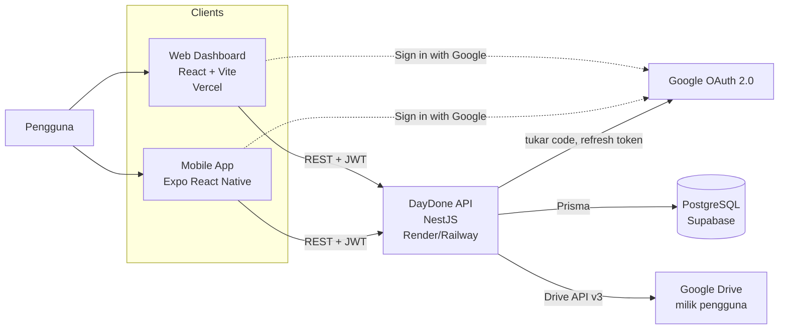
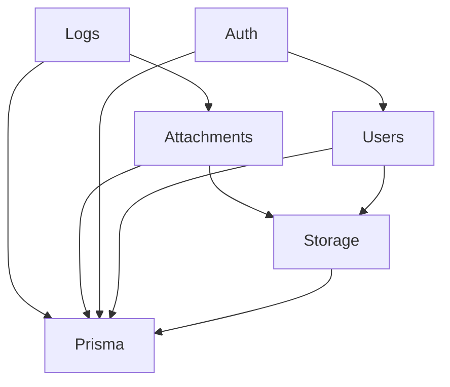
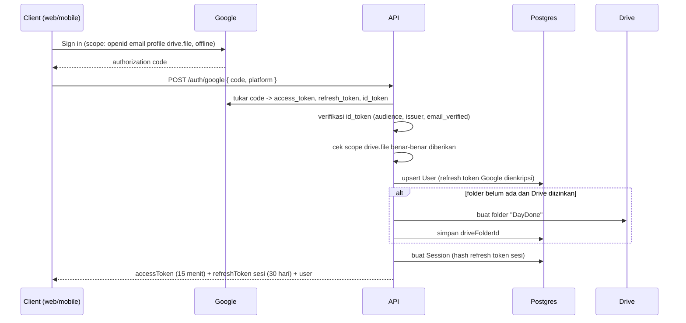
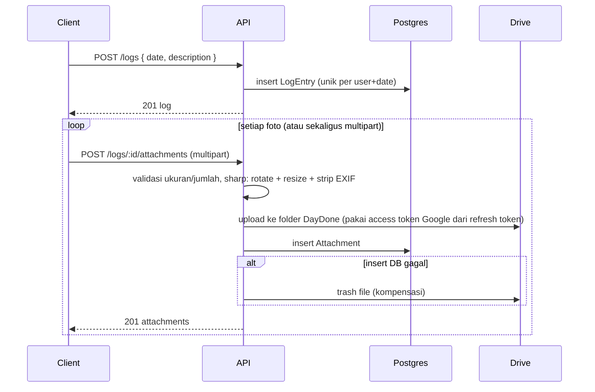
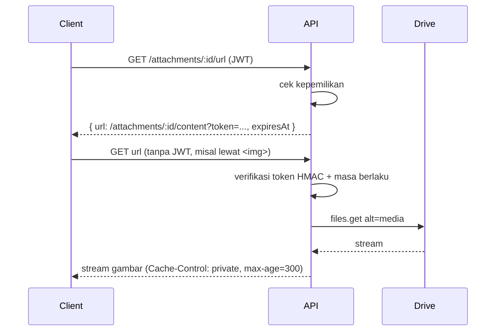
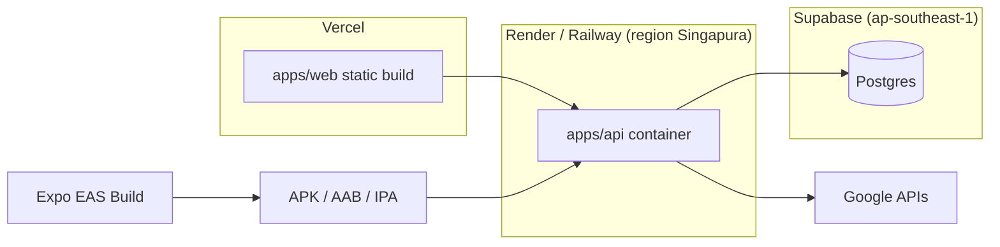

# 02 — Arsitektur dan Desain Sistem

## 1. Konteks sistem



Prinsip utamanya:

- **Satu API untuk semua client.** Web dan mobile tidak punya logika bisnis sendiri. Mereka hanya menampilkan data dan memanggil API.
- **Client tidak pernah memegang token Google jangka panjang.** Client hanya mendapat *authorization code* sekali saat login, lalu menyerahkannya ke API. Setelah itu client memakai JWT DayDone.
- **File tidak pernah publik.** Semua akses foto lewat API dengan pemeriksaan kepemilikan.

## 2. Komponen

| Komponen | Tanggung jawab | Teknologi |
|---|---|---|
| `apps/api` | Autentikasi, logika logbook, integrasi Drive, validasi | NestJS (ESM), Prisma 7, Zod, googleapis, google-auth-library, sharp |
| `apps/web` | Dashboard: login, daftar/detail/form logbook, unggah foto | React, Vite, React Router, TanStack Query, Tailwind |
| `apps/mobile` | Pencatatan cepat dari HP, kamera, galeri | Expo, expo-router, TanStack Query, expo-secure-store, expo-image-picker, expo-image-manipulator |
| `packages/shared` | Schema Zod request, tipe response, konstanta (batas ukuran file, dll) | TypeScript + Zod |
| Supabase | Hanya PostgreSQL (Auth dan Storage Supabase tidak dipakai) | Postgres |
| Google Cloud | OAuth consent screen, OAuth client (Web, Android, iOS), Drive API | — |

## 3. Struktur modul NestJS

```
apps/api/src/
├── main.ts                     bootstrap, prefix api/v1, CORS, pipe global, helmet
├── app.module.ts
├── generated/prisma/           hasil prisma generate (di-.gitignore)
├── config/
│   ├── env.schema.ts           validasi env dengan Zod
│   └── config.module.ts
├── prisma/
│   ├── prisma.module.ts        @Global
│   └── prisma.service.ts       PrismaClient + PrismaPg adapter
├── common/
│   ├── date.ts                 helper konversi YYYY-MM-DD <-> Date
│   ├── crypto/                 EncryptionService (AES-256-GCM), hashing token
│   ├── errors/                 DomainException + kode error
│   ├── filters/                filter global (Prisma error -> HTTP)
│   └── decorators/             @CurrentUser(), @Public()
├── health/                     GET /health
├── auth/
│   ├── auth.controller.ts      /auth/google, /auth/refresh, /auth/logout, /auth/me
│   ├── auth.service.ts         alur login, penerbitan token
│   ├── google-oauth.service.ts tukar code, verifikasi id_token, refresh access token Google
│   ├── sessions.service.ts     refresh token sesi: buat, rotasi, cabut
│   ├── jwt-auth.guard.ts       guard global (kecuali @Public)
│   └── dto/
├── users/                      GET/DELETE /users/me
├── logs/                       CRUD logbook
├── attachments/                unggah, URL bertanda tangan, konten, hapus
└── storage/
    ├── storage.provider.ts     interface StorageProvider + token injeksi
    ├── google-drive.storage.ts implementasi Drive
    └── image-processor.ts      sharp: rotate, resize, strip metadata
```

### Ketergantungan antar modul



Aturan: `Logs` tidak tahu soal Drive secara langsung; `Logs` mengimpor `Attachments` untuk menghasilkan URL lampiran dan memicu penghapusan file di storage saat logbook dihapus. `AttachmentsService` memverifikasi kepemilikan logbook langsung lewat `PrismaService` (`logEntry.userId`). `Storage` mengimplementasikan abstraksi `StorageProvider`. `Users` memakai `Storage` saat mencabut akses atau inisialisasi.

### Struktur packages/shared (`@daydone/shared`)

Paket bersama tanpa ketergantungan framework. Berisi kontrak data tunggal yang dipakai bersama oleh `apps/api`, `apps/web`, dan kelak `apps/mobile`:

```
packages/shared/src/
├── index.ts                titik ekspor utama
├── constants.ts            konstanta domain (MAX_ATTACHMENTS, MAX_FILE_SIZE_BYTES, dll)
├── errors.ts               enum ErrorCode dan pemetaan pesan Indonesia (ERROR_MESSAGES)
├── schemas/                skema Zod untuk validasi request DTO
│   ├── log.schema.ts       create, update, list query, by-date
│   ├── auth.schema.ts      google login, refresh, logout
│   └── delete-user.schema.ts konfirmasi hapus akun
└── types/                  antarmuka TypeScript entitas & response API
    ├── api.types.ts        ApiError, PaginationMeta, Paginated<T>
    ├── auth.types.ts       AuthResponse, RefreshResponse, UserProfileResponse
    ├── log.types.ts        Log, LogListItem
    ├── attachment.types.ts Attachment
    └── user.types.ts       User, DriveStatus
```

### Struktur apps/web (Web Dashboard)

Aplikasi Single Page Application (SPA) berbasis Vite + React 19 + Tailwind CSS:

```
apps/web/src/
├── main.tsx                entry point React, mount root
├── App.tsx                 routing React Router (public vs protected routes)
├── index.css               Tailwind CSS
├── api/                    klien API terpusat
│   ├── client.ts           fetch wrapper, in-memory token, single-flight refresh, CSRF
│   └── api-error.ts        subclass Error dengan kode domain dan translasi pesan
├── auth/                   state manajemen autentikasi & GIS popup
│   ├── auth-context.tsx    AuthProvider, useAuth, session recovery dari cookie
│   └── google-login-button.tsx tombol GIS initCodeClient (auth-code popup)
├── components/             komponen UI dan guards
│   ├── loading-screen.tsx  indikator loading saat bootstrap sesi
│   ├── protected-route.tsx guard rute yang membutuhkan login
│   └── public-route.tsx    guard rute publik (mengalihkan ke dashboard bila sudah login)
└── pages/                  halaman aplikasi
    ├── login-page.tsx      layar masuk Google
    └── dashboard-page.tsx  dashboard utama (placeholder M7-A)
```

## 4. Abstraksi penyimpanan

```ts
export interface StoredFile {
  fileId: string;
  sizeBytes: number;
}

export interface StorageProvider {
  /** Buat (atau pastikan ada) folder aplikasi milik pengguna, kembalikan id-nya. */
  ensureAppFolder(userId: string): Promise<string>;
  upload(userId: string, input: {
    fileName: string;
    mimeType: string;
    data: Buffer;
  }): Promise<StoredFile>;
  download(userId: string, fileId: string): Promise<{
    stream: NodeJS.ReadableStream;
    mimeType: string;
    sizeBytes?: number;
  }>;
  /** Pindahkan ke Trash, bukan hapus permanen. */
  trash(userId: string, fileId: string): Promise<void>;
}

export const STORAGE_PROVIDER = Symbol('STORAGE_PROVIDER');
```

Manfaatnya: test memakai implementasi palsu (`InMemoryStorageProvider`) tanpa memanggil Google, dan bila kelak ditambah opsi Cloudflare R2, modul lain tidak perlu diubah.

## 5. Alur utama

### 5.1 Login (web dan mobile)



### 5.2 Membuat logbook dengan foto



Logbook dibuat dulu, baru foto diunggah. Dengan begitu kegagalan unggah tidak menghilangkan teks logbook, dan client bisa menampilkan progres per foto.

### 5.3 Menampilkan foto



Untuk efisiensi, `GET /logs/:id` dan `GET /logs` sudah menyertakan `url` bertanda tangan untuk setiap lampiran, sehingga client tidak perlu memanggil `/url` satu per satu.

### 5.4 Refresh sesi

Access token berumur 15 menit. Saat client mendapat `401`, client memanggil `POST /auth/refresh` sekali, lalu mengulang request. Refresh token dirotasi setiap dipakai. Bila refresh token lama dipakai lagi (indikasi pencurian), seluruh sesi pengguna dicabut. Detail di `docs/05-auth-and-storage.md`.

## 6. Penanganan error

| Sumber | Contoh | Respons ke client |
|---|---|---|
| Validasi Zod | deskripsi kosong | `400` dengan daftar pesan |
| Tidak ditemukan / bukan milik user | id logbook orang lain | `404` |
| Konflik | tanggal sudah dipakai (Prisma P2002) | `409`, `code: LOG_DATE_CONFLICT` |
| Drive: akses dicabut/expired (`invalid_grant`) | — | `409`, `code: DRIVE_RECONNECT_REQUIRED`, `User.driveStatus = NEEDS_RECONNECT` |
| Drive: penyimpanan penuh | `storageQuotaExceeded` | `507`, `code: DRIVE_STORAGE_FULL` |
| Drive: error lain / timeout | 5xx Google | `502`, `code: DRIVE_UNAVAILABLE` |
| Tak terduga | bug | `500` tanpa detail internal; detail hanya di log server |

Format error mengikuti bentuk bawaan NestJS dengan tambahan `code` opsional. Lihat `docs/04-api-spec.md`.

## 7. Topologi deployment



Semua komponen server ditempatkan di region Singapura karena terdekat dengan pengguna di Indonesia. Bila memungkinkan, pakai domain kustom dengan subdomain bersama (misal `app.daydone.app` dan `api.daydone.app`) agar cookie refresh token web berstatus *same-site* (lihat ADR-0003).

## 8. Perkiraan beban

Asumsi 1.000 pengguna aktif, masing-masing 1 logbook/hari dan rata-rata 2 foto:

- Tulis: ~1.000 logbook + ~2.000 unggahan per hari, terkonsentrasi sore hari. Puncak kira-kira beberapa request per detik, jauh di bawah kemampuan satu instance kecil.
- Database: ~365.000 baris logbook per tahun, ukurannya kecil (teks saja).
- Drive API: setiap unggah/tampil foto memanggil Drive. Kuota per proyek Google Cloud cukup besar untuk skala ini, tetapi tampilan foto yang berulang sebaiknya di-cache di sisi client (header `Cache-Control`).
- Memori API: pemrosesan sharp menahan gambar di memori. Batasi konkurensi pemrosesan gambar (misal 2–3 sekaligus) agar instance kecil (512 MB) tidak kehabisan memori.

## 9. Observability

- Logging terstruktur bawaan Nest Logger, dengan request id. Token dan header `Authorization` tidak pernah di-log.
- NestJS Observe (opsional, sudah ditawarkan saat pembuatan proyek) untuk request, error, dan trace. API key disimpan di env, tidak di-commit.
- Endpoint `GET /health` memeriksa API dan koneksi database, dipakai sebagai health check platform deploy.

## 10. Hal yang perlu ditinjau ulang saat sistem tumbuh

| Pemicu | Tinjauan |
|---|---|
| Unggahan besar membebani memori/bandwidth API | Pindah ke resumable upload langsung dari client ke Drive (ADR-0005) |
| Tampilan foto memperlambat API | Pakai thumbnail Drive atau cache di CDN dengan URL bertanda tangan |
| Pengguna ingin opsi selain Drive | Implementasi `StorageProvider` kedua (R2) |
| Fitur ekspor PDF | Job asynchronous (antrean) agar tidak memblokir request |
| Lebih dari satu instance API | Pastikan tidak ada state di memori; rate limiter perlu storage bersama (Redis) |
