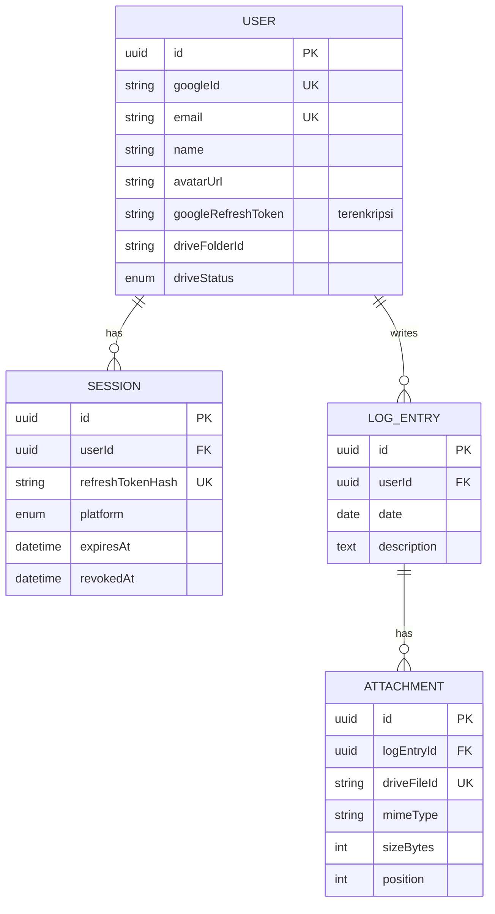

# 03 — Model Data

## 1. Diagram relasi



## 2. Skema Prisma

File: `apps/api/prisma/schema.prisma`

```prisma
generator client {
  provider = "prisma-client"
  output   = "../src/generated/prisma"
}

datasource db {
  provider = "postgresql"
  // Prisma 7: URL koneksi didefinisikan di prisma.config.ts (untuk CLI)
  // dan di PrismaPg adapter (untuk runtime), bukan di sini.
}

enum DriveStatus {
  NOT_CONNECTED   // pengguna tidak memberi izin drive.file
  CONNECTED
  NEEDS_RECONNECT // refresh token dicabut/kedaluwarsa
}

enum ClientPlatform {
  WEB
  MOBILE
}

model User {
  id                 String      @id @default(uuid()) @db.Uuid
  googleId           String      @unique
  email              String      @unique
  name               String?
  avatarUrl          String?
  /// Refresh token Google, terenkripsi AES-256-GCM. Tidak pernah dikirim ke client.
  googleRefreshToken String?
  driveFolderId      String?
  driveStatus        DriveStatus @default(NOT_CONNECTED)
  createdAt          DateTime    @default(now())
  updatedAt          DateTime    @updatedAt

  sessions Session[]
  logs     LogEntry[]

  @@map("users")
}

model Session {
  id               String         @id @default(uuid()) @db.Uuid
  userId           String         @db.Uuid
  user             User           @relation(fields: [userId], references: [id], onDelete: Cascade)
  /// SHA-256 dari refresh token sesi. Token asli tidak disimpan.
  refreshTokenHash String         @unique
  platform         ClientPlatform
  userAgent        String?
  expiresAt        DateTime
  revokedAt        DateTime?
  /// Diisi saat token dirotasi; dipakai untuk deteksi pemakaian ulang.
  replacedById     String?        @db.Uuid
  createdAt        DateTime       @default(now())

  @@index([userId])
  @@map("sessions")
}

model LogEntry {
  id          String       @id @default(uuid()) @db.Uuid
  userId      String       @db.Uuid
  user        User         @relation(fields: [userId], references: [id], onDelete: Cascade)
  /// Tanggal kalender lokal pengguna, tanpa jam dan zona waktu.
  date        DateTime     @db.Date
  description String       @db.Text
  createdAt   DateTime     @default(now())
  updatedAt   DateTime     @updatedAt

  attachments Attachment[]

  @@unique([userId, date])
  @@map("log_entries")
}

model Attachment {
  id          String   @id @default(uuid()) @db.Uuid
  logEntryId  String   @db.Uuid
  logEntry    LogEntry @relation(fields: [logEntryId], references: [id], onDelete: Cascade)
  driveFileId String   @unique
  fileName    String
  mimeType    String
  sizeBytes   Int
  width       Int?
  height      Int?
  /// Urutan tampil di dalam logbook (0, 1, 2, ...).
  position    Int      @default(0)
  createdAt   DateTime @default(now())

  @@index([logEntryId, position])
  @@map("attachments")
}
```

Catatan:

- `@@unique([userId, date])` sekaligus membuat index untuk query "logbook milik user X dalam rentang tanggal", jadi tidak perlu index tambahan untuk daftar logbook.
- Pencarian `search` memakai `contains` + `mode: 'insensitive'` (ILIKE). Untuk skala MVP ini cukup. Bila lambat, tambahkan index trigram (`pg_trgm`) lewat migrasi SQL manual.
- `onDelete: Cascade` membuat penghapusan user menghapus semua data turunannya di database. File di Drive **tidak** ikut terhapus otomatis; itu ditangani di service.

## 3. Konfigurasi Prisma 7

`apps/api/prisma.config.ts`:

```ts
import 'dotenv/config';
import { defineConfig, env } from 'prisma/config';

export default defineConfig({
  schema: 'prisma/schema.prisma',
  migrations: { path: 'prisma/migrations' },
  datasource: {
    // CLI (migrate, studio) memakai koneksi langsung / session pooler
    url: env('DIRECT_URL'),
  },
});
```

`apps/api/src/prisma/prisma.service.ts`:

```ts
import { Injectable, OnModuleDestroy } from '@nestjs/common';
import { ConfigService } from '@nestjs/config';
import { PrismaPg } from '@prisma/adapter-pg';
import { PrismaClient } from '../generated/prisma/client.js';

@Injectable()
export class PrismaService extends PrismaClient implements OnModuleDestroy {
  constructor(config: ConfigService) {
    super({
      adapter: new PrismaPg({
        connectionString: config.getOrThrow<string>('DATABASE_URL'),
      }),
    });
  }

  async onModuleDestroy() {
    await this.$disconnect();
  }
}
```

Dependency: `prisma` (dev), `@prisma/client`, `@prisma/adapter-pg`, `pg`, `dotenv`.

> Prisma 7 mengubah cukup banyak hal dibanding versi sebelumnya (config file, driver adapter wajib, lokasi client). Bila nama opsi di atas berbeda dengan versi yang terpasang, ikuti dokumentasi resmi Prisma (panduan NestJS) dan perbarui dokumen ini.

Tambahkan `src/generated/` ke `.gitignore`, dan jalankan `prisma generate` di script `postinstall` atau `prebuild` agar build di server deploy tidak gagal.

## 4. Aturan tanggal

Tanggal logbook adalah sumber bug paling umum. Aturannya:

1. **Di API**: selalu string `YYYY-MM-DD`, divalidasi `z.iso.date()`.
2. **Ke database**: `toDbDate(date)`, yaitu tengah malam UTC pada tanggal tersebut.
3. **Dari database**: `value.toISOString().slice(0, 10)`.
4. **"Hari ini"** ditentukan oleh **client** (perangkat pengguna), bukan server. Server tidak pernah menebak tanggal logbook.
5. Jangan pernah memakai `getDate()`, `getMonth()`, atau `toLocaleDateString()` di server untuk tanggal logbook.

Helper wajib di `src/common/date.ts`:

```ts
export function toDbDate(isoDate: string): Date {
  return new Date(`${isoDate}T00:00:00.000Z`);
}

export function fromDbDate(value: Date): string {
  return value.toISOString().slice(0, 10);
}
```

## 5. Pemetaan ke response

Service mengembalikan entitas Prisma; controller atau mapper mengubahnya ke bentuk response di `docs/04-api-spec.md`. Field yang **tidak boleh** keluar dari API: `googleRefreshToken`, `googleId`, `driveFolderId`, `refreshTokenHash`, `driveFileId`.

## 6. Aturan migrasi

- Nama migrasi deskriptif dan snake_case: `init`, `add_sessions`, `add_attachment_position`.
- Migrasi yang sudah ter-commit tidak boleh diedit. Perbaikan selalu lewat migrasi baru.
- Produksi menjalankan `prisma migrate deploy` (bukan `migrate dev`) sebagai bagian dari proses deploy.
- Perubahan yang berisiko kehilangan data (hapus kolom, ubah tipe) harus disetujui pemilik proyek dulu.

## 7. Data seed untuk development

`prisma/seed.ts` membuat satu user dev (`dev@daydone.local`, `driveStatus: NOT_CONNECTED`) dan 10 logbook contoh pada tanggal berurutan. Seed hanya boleh dijalankan di lingkungan development.
